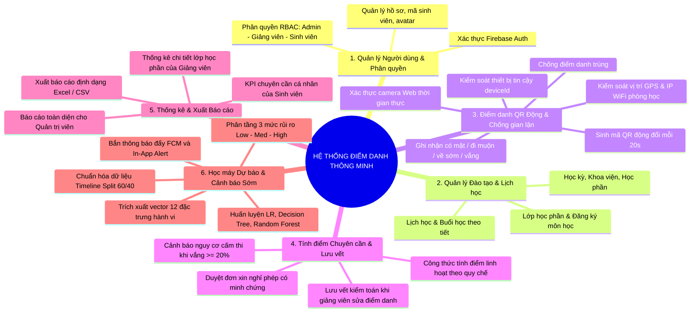
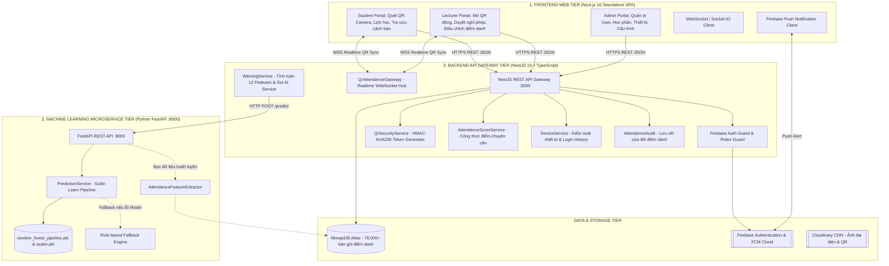
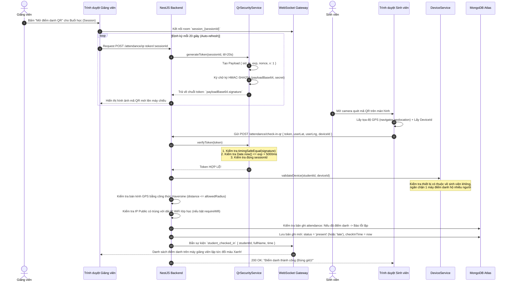

# HỆ THỐNG ĐIỂM DANH THÔNG MINH TÍCH HỢP CẢNH BÁO ĐIỂM CHUYÊN CẦN TRÊN NỀN TẢNG WEB
> **Tài liệu Kỹ thuật Chuyên sâu, Luồng hoạt động End-to-End, Bản đồ Source Code và Cẩm nang 25 Câu hỏi Bảo vệ Đồ án**

---

## MỤC LỤC
1. [Giới thiệu tổng quan hệ thống (Deep-dive Overview)](#1-giới-thiệu-tổng-quan-hệ-thống-deep-dive-overview)
   - 1.1. [Bối cảnh đào tạo tín chỉ & Bài toán thực tế](#11-bối-cảnh-đào-tạo-tín-chỉ--bài-toán-thực-tế)
   - 1.2. [Hạn chế của các phương pháp điểm danh truyền thống](#12-hạn-chế-của-các-phương-pháp-điểm-danh-truyền-thống)
   - 1.3. [Giải pháp của đề tài](#13-giải-pháp-của-đề-tài)
   - 1.4. [Mô tả chi tiết các Chức năng Cơ bản theo Phiếu giao Đề tài](#14-mô-tả-chi-tiết-các-chức-năng-cơ-bản-theo-phiếu-giao-đề-tài)
2. [Kiến trúc hệ thống chi tiết (Deep-dive Architecture)](#2-kiến-trúc-hệ-thống-chi-tiết-deep-dive-architecture)
3. [Luồng hoạt động chi tiết (End-to-End Deep-dive Flows)](#3-luồng-hoạt-động-chi-tiết-end-to-end-deep-dive-flows)
4. [Hướng dẫn đọc Source Code toàn diện (Full Codebase Walkthrough)](#4-hướng-dẫn-đọc-source-code-toàn-diện-full-codebase-walkthrough)
5. [Ma trận Mapping chi tiết Phiếu đề tài ⟷ Source Code](#5-ma-trận-mapping-chi-tiết-phiếu-đề-tài--source-code)
6. [Bộ 25 câu hỏi phản biện thường gặp khi bảo vệ đồ án (Kèm gợi ý trả lời chuyên sâu)](#6-bộ-25-câu-hỏi-phản-biện-thường-gặp-khi-bảo-vệ-đồ-án-kèm-gợi-ý-trả-lời-chuyên-sâu)

---

## 1. GIỚI THIỆU TỔNG QUAN HỆ THỐNG (DEEP-DIVE OVERVIEW)

### 1.1. Bối cảnh đào tạo tín chỉ & Bài toán thực tế
Theo Quy chế đào tạo trình độ đại học theo học chế tín chỉ (Thông tư số 08/2021/TT-BGDĐT của Bộ Giáo dục và Đào tạo):
- **Điều kiện tiên quyết dự thi:** Sinh viên vắng mặt quá **20% tổng số tiết/buổi học** của một học phần sẽ **bị đình chỉ thi (cấm thi)** và bắt buộc phải đăng ký học lại.
- **Trọng số điểm chuyên cần:** Điểm đánh giá bộ phận thường chiếm từ **10% đến 20%** tổng điểm môn học. Điểm chuyên cần thấp (dưới $7.0/10$) kéo tụt đáng kể điểm trung bình chung tích lũy (GPA) và tiềm ẩn nguy cơ bị cảnh báo học vụ.
- **Dấu hiệu cảnh báo sớm (Early Indicators):** Nghiên cứu hành vi học tập cho thấy sinh viên có chuỗi vắng liên tiếp từ **2 đến 3 buổi** thường là chỉ dấu của sự sa sút động lực, có ý định bỏ học hoặc gặp biến cố cá nhân.

### 1.2. Hạn chế của các phương pháp điểm danh truyền thống
1. **Điểm danh thủ công bằng giấy / Đọc tên:** Tốn từ 10 – 15 phút đầu mỗi buổi học của giảng viên; dễ gian lận điểm danh hộ; sai sót khi tổng hợp cuối kỳ.
2. **Điểm danh bằng thẻ từ / Vân tay tĩnh tại cửa phòng:** Tắc nghẽn giờ vào lớp; chi phí phần cứng cao; không thể kiểm soát việc sinh viên quẹt thẻ xong rồi bỏ về giữa buổi.
3. **Mã QR tĩnh (Static QR):** Rất dễ bị chụp ảnh màn hình rồi gửi qua Zalo/Messenger cho các sinh viên đang ở nhà điểm danh từ xa (Buddy Punching).
4. **Hệ thống phần mềm hiện hành mang tính "sổ ghi chép thụ động":** Chỉ đơn thuần lưu vết có mặt/vắng mặt. Đến cuối kỳ (tuần thứ 15) mới xuất danh sách cấm thi thì mọi can thiệp sư phạm (nhắc nhở, tư vấn học vụ) đều đã quá muộn!

### 1.3. Giải pháp của đề tài
Hệ thống **Điểm danh Thông minh Tích hợp Cảnh báo Điểm Chuyên cần** giải quyết trọn vẹn cả 2 khía cạnh: **Vận hành thời gian thực** và **Phân tích dự báo thông minh**:
- **Điểm danh bằng Mã QR động có thời hạn (Dynamic Expiring QR):** Mã QR được tái tạo tự động trên màn hình giảng viên mỗi 20 giây một lần với chữ ký mật mã **HMAC-SHA256**, kèm mã chống phát lại (`nonce`). Sinh viên không thể chụp ảnh gửi ra ngoài vì mã sẽ hết hạn trong vài giây.
- **Kiểm soát đa lớp chống gian lận (Multi-layer Anti-fraud):** Kiểm tra bán kính tọa độ địa lý **GPS (Haversine Formula)**, đối soát địa chỉ **Public IP / WiFi lớp học**, và cơ chế **khóa định danh thiết bị (`deviceId`)** ngăn chặn một máy đăng nhập nhiều tài khoản để điểm danh hộ.
- **Cơ chế tính điểm & Lưu vết điều chỉnh (Audit Trail):** Tính điểm chuyên cần tự động dựa trên cấu hình linh hoạt (trừ điểm vắng, đi muộn, về sớm, nghỉ có phép). Khi giảng viên sửa trạng thái điểm danh, hệ thống bắt buộc nhập lý do và ghi nhận lịch sử vào bảng kiểm toán (`attendance_audits`).
- **Phân hệ Học máy Cảnh báo sớm (Early Warning Machine Learning):**
  - Áp dụng phương pháp luận chuỗi thời gian **Timeline Split (Quan sát 60% đầu kỳ $\rightarrow$ Dự báo kết quả cuối kỳ 100%)** triệt tiêu hoàn toàn lỗi rò rỉ dữ liệu (Data Leakage).
  - Trích xuất vector **12 đặc trưng hành vi chuyên cần** (tỷ lệ vắng, tốc độ sa sút 3 buổi gần nhất, chuỗi vắng liên tiếp, xu hướng điểm danh).
  - So sánh thực nghiệm 3 mô hình học máy truyền thống: **Logistic Regression**, **Decision Tree** và **Random Forest**. Lựa chọn mô hình tối ưu Random Forest ($F_1 = 93.50\%$, Precision $99.67\%$, ROC-AUC $0.9768$).
  - Phân tầng 3 cấp độ rủi ro (🟢 Low - 🟡 Medium - 🔴 High) và gửi cảnh báo đẩy qua **Firebase Cloud Messaging (FCM)** đến thiết bị sinh viên và giảng viên.

### 1.4. Mô tả chi tiết các Chức năng Cơ bản theo Phiếu giao Đề tài
Dựa trên các yêu cầu nghiệp vụ trong Phiếu giao đề tài, hệ thống được thiết kế hoàn chỉnh thành **6 nhóm phân hệ chức năng cốt lõi** phục vụ cho **3 tác nhân** (Quản trị viên, Giảng viên, Sinh viên):



#### 1.4.1. Phân hệ Quản lý Người dùng & Xác thực Phân quyền (User & Auth Module)
- **Xác thực an toàn:** Hỗ trợ đăng nhập bằng Email/Password và tài khoản Google thông qua **Firebase Authentication**, tạo JWT token bảo mật cho từng phiên làm việc.
- **Phân quyền người dùng (RBAC - Role-Based Access Control) theo 3 tác nhân:**
  - **Quản trị viên (Admin / Super Admin):** 
    - Toàn quyền CRUD (thêm, sửa, xóa, tìm kiếm, kích hoạt/khóa) tài khoản người dùng trong toàn trường.
    - Phân bổ vai trò, quản lý danh sách thiết bị truy cập, cấu hình các tham số hệ thống chung.
  - **Giảng viên (Lecturer / Teacher):**
    - Quản lý danh sách các lớp học phần được phân công giảng dạy.
    - Xem danh sách sinh viên đăng ký môn học, tạo mã QR động cho từng buổi học, duyệt đơn xin nghỉ phép, điều chỉnh điểm danh và tra cứu thống kê lớp học.
  - **Sinh viên (Student):**
    - Xem lịch học, thời khóa biểu cá nhân theo ngày/tuần.
    - Bật camera quét mã QR động để điểm danh vào (Check-in) và điểm danh ra (Check-out).
    - Nộp đơn xin nghỉ có phép đính kèm ảnh chụp minh chứng (giấy khám bệnh, giấy triệu tập).
    - Theo dõi lịch sử chuyên cần cá nhân và nhận các cảnh báo nguy cơ cấm thi từ hệ thống.

#### 1.4.2. Phân hệ Quản lý Đào tạo, Lịch học & Buổi học (Academic Scheduling Module)
- **Quản lý danh mục học vụ:** Quản lý thông tin Học kỳ (`Semester`), Khoa viện (`Faculty`), Môn học / Học phần (`Subject` - mã môn, tên môn, số tín chỉ, số tiết lý thuyết/thực hành).
- **Quản lý Lớp học phần (`CourseSection`):** Quản lý mã lớp học phần, môn học, giảng viên phụ trách, sĩ số tối đa, danh sách sinh viên ghi danh (`Enrollment`).
- **Quản lý Lịch học & Buổi học cụ thể (`ClassSession`):**
  - Tự động sinh danh sách $N$ buổi học theo thời khóa biểu học kỳ.
  - Quản lý chi tiết từng buổi học: Ngày học, phòng học, tiết bắt đầu (`startPeriod`), số tiết (`numPeriods`), thời gian bắt đầu/kết thúc chuẩn theo cấu hình khung giờ tiết học (`PeriodConfig`).
  - Cập nhật trạng thái buổi học: `scheduled` (chưa diễn ra), `in-progress` (đang diễn ra), `completed` (đã kết thúc), `cancelled` (nghỉ/hủy buổi).

#### 1.4.3. Phân hệ Điểm danh QR Động & Kiểm soát Chống Gian lận (Dynamic QR & Anti-fraud Module)
- **Tạo mã QR động có thời hạn (Dynamic Expiring QR):**
  - Giảng viên kích hoạt mở điểm danh cho buổi học trên Web.
  - Hệ thống tự động làm mới mã QR định kỳ mỗi **20 giây** một lần với chữ ký mật mã **HMAC-SHA256**, kèm chuỗi muối ngẫu nhiên (`nonce`) và thời gian hết hạn (`exp`).
  - Cho phép giảng viên tùy chỉnh thời gian hết hạn mã (TTL từ 15s đến 60s).
- **Ghi nhận trạng thái tham dự đa dạng:**
  - **Có mặt (Present):** Điểm danh vào trong khoảng thời gian ân hạn (`gracePeriodMinutes`, ví dụ: trong 10 phút đầu buổi học).
  - **Đi muộn (Late):** Điểm danh sau thời gian ân hạn nhưng trước ngưỡng muộn tối đa (`lateThresholdMinutes`, ví dụ: sau 10 phút đến 30 phút).
  - **Về sớm (Early leave):** Thực hiện điểm danh ra (Check-out) trước khi buổi học kết thúc.
  - **Vắng mặt (Absent):** Không thực hiện điểm danh hoặc vào lớp sau ngưỡng muộn tối đa (sau 30 phút).
  - **Nghỉ có phép (Excused):** Được giảng viên duyệt đơn xin nghỉ phép hợp lệ.
- **Cơ chế chống điểm danh trùng (Idempotent Check-in):** Ràng buộc duy nhất `unique index` trên cặp `(classSessionId, studentId)` trong cơ sở dữ liệu ngăn chặn việc sinh viên quét mã nhiều lần cho một buổi học.
- **Kiểm soát Thiết bị truy cập (`UserDevice` & `deviceId`):**
  - Nhận diện mã định danh phần cứng/trình duyệt của thiết bị khi đăng nhập.
  - Sinh viên chỉ được phép sử dụng thiết bị tin cậy đã đăng ký; nếu dùng thiết bị khác để đăng nhập tài khoản nhằm điểm danh hộ sẽ bị hệ thống phát hiện và chặn lại.
  - Ghi nhận nhật ký đăng nhập chi tiết (`LoginHistory`): IP, thiết bị, hệ điều hành, trình duyệt.
- **Kiểm soát Vị trí địa lý & Mạng WiFi:**
  - **Vị trí GPS:** Đo khoảng cách mặt cầu giữa tọa độ sinh viên gửi lên và tọa độ giảng đường theo công thức **Haversine**, từ chối điểm danh nếu khoảng cách vượt quá bán kính cho phép (mặc định 50 mét).
  - **IP WiFi phòng học:** Đối soát địa chỉ Public IP của sinh viên với dải IP WiFi trường học cấu hình trong buổi học, ngăn chặn sinh viên ở nhà Fake GPS để điểm danh từ xa.

#### 1.4.4. Phân hệ Tính Điểm Chuyên cần & Lưu vết Điều chỉnh (Attendance Scoring & Audit Module)
- **Tính điểm chuyên cần theo cấu hình linh hoạt (`AttendanceConfig`):**
  - Cho phép nhà trường/giảng viên thiết lập: Điểm khởi tạo ban đầu (10.0), mức trừ điểm vắng không phép (2.0 đ/buổi), mức trừ đi muộn (0.5 đ/buổi), mức trừ về sớm (0.5 đ/buổi), mức trừ nghỉ có phép (0.0 đ/buổi).
  - Tính toán tỷ lệ tham dự (`attendanceRate`), tỷ lệ vắng mặt (`absenceRate`) và điểm chuyên cần tích lũy thời gian thực.
  - **Tự động gắn cờ nguy cơ cấm thi:** Khi $\text{absenceRate} \ge 20\%$, hệ thống tự động bật cờ `examBanRisk = true`.
- **Quản lý Đơn xin nghỉ có phép (`LeaveRequest`):**
  - Sinh viên gửi đơn trực tuyến trước hoặc sau buổi học, chọn buổi nghỉ, lý do và tải lên ảnh minh chứng.
  - Giảng viên tiếp nhận đơn, xem minh chứng và bấm Duyệt (`approved`) hoặc Từ chối (`rejected`). Khi duyệt, trạng thái điểm danh buổi đó tự động chuyển thành `excused`.
- **Lưu vết kiểm toán điều chỉnh (Attendance Audit Trail):**
  - Giảng viên có quyền điều chỉnh thủ công trạng thái của sinh viên (chuyển giữa có mặt, vắng, muộn, có phép).
  - Hệ thống **bắt buộc giảng viên phải nhập lý do điều chỉnh** và ghi nhận vĩnh viễn vào bảng `attendance_audits`: lưu ID giảng viên thực hiện (`updatedBy`), trạng thái cũ (`previousStatus`), trạng thái mới (`newStatus`), lý do (`reason`) và thời gian thực hiện (`createdAt`).

#### 1.4.5. Phân hệ Thống kê, Tra cứu & Xuất Báo cáo (Statistics & Reporting Module)
- **Tra cứu & Thống kê cá nhân dành cho Sinh viên:** Bảng tổng kết số buổi có mặt, đi muộn, vắng mặt, tỷ lệ chuyên cần (%) và điểm số dự kiến cho từng môn học đang theo học.
- **Thống kê chi tiết dành cho Giảng viên:**
  - Biểu đồ tỷ lệ chuyên cần theo từng buổi học của lớp học phần.
  - Danh sách sinh viên có tỷ lệ vắng cao, danh sách sinh viên có nguy cơ cấm thi cần lưu ý.
- **Thống kê toàn diện dành cho Quản trị viên:** Tổng số lượt điểm danh toàn trường, tỷ lệ đi học đúng giờ theo khoa/ngành, danh sách sinh viên bị cấm thi trên toàn hệ thống.
- **Xuất báo cáo:** Hỗ trợ xuất dữ liệu điểm danh và bảng điểm chuyên cần ra file **Excel (.xlsx)** hoặc **CSV** chuẩn mẫu phục vụ nộp cho Phòng Đào tạo / Thanh tra giáo dục.

#### 1.4.6. Phân hệ Học máy Dự báo & Cảnh báo Sớm (Machine Learning Early Warning Module)
- **Chuẩn hóa dữ liệu & Phương pháp luận Timeline Split 60/40:** Phân chia quá trình học thành 60% đầu kỳ làm Cửa sổ quan sát (Observation Window) và 40% cuối kỳ làm Cửa sổ hệ quả (Outcome Window), loại bỏ hoàn toàn hiện tượng rò rỉ dữ liệu (Data Leakage).
- **Trích xuất Vector 12 đặc trưng hành vi:** Tổng hợp số buổi vắng/muộn, tỷ lệ tham gia, tỷ lệ vắng 3 buổi gần nhất (`recent_absence_rate`), chuỗi vắng liên tiếp (`consecutive_absence`), và xu hướng cải thiện/sa sút (`attendance_trend`).
- **Mô hình học máy truyền thống tối ưu:**
  - Huấn luyện và so sánh 3 mô hình: **Logistic Regression**, **Decision Tree** và **Random Forest** trên 1,989 mẫu dữ liệu.
  - Đánh giá định lượng bằng Accuracy, Precision, Recall, F1-score, ROC-AUC và Ma trận nhầm lẫn.
  - Lựa chọn mô hình Random Forest ($F_1 = 93.50\%$, Precision $99.67\%$, ROC-AUC $0.9768$, chỉ duy nhất 1 ca False Positive).
- **Phân tầng 3 mức rủi ro & Khuyến nghị học vụ:**
  - 🟢 **Mức 1 - LOW (An toàn):** Xác suất rủi ro $P < 0.35$.
  - 🟡 **Mức 2 - MEDIUM (Cần chú ý):** Xác suất rủi ro $0.35 \le P < 0.70$, sinh khuyến nghị nhắc nhở sinh viên cải thiện.
  - 🔴 **Mức 3 - HIGH (Nguy cơ cao cấm thi):** Xác suất rủi ro $P \ge 0.70$ hoặc vắng $\ge 20\%$.
- **Tích hợp cảnh báo đa kênh:**
  - Hiển thị nhãn cảnh báo màu sắc trực quan kèm câu khuyến nghị trên giao diện Web Dashboard của cả Giảng viên và Sinh viên.
  - Tự động kích hoạt gửi thông báo đẩy **Firebase Cloud Messaging (FCM)** tức thời đến thiết bị của sinh viên khi rơi vào mức nguy cơ cao.
  - Cơ chế **Graceful Fallback:** Tự động chuyển sang bộ luật Rule-based nếu AI Service gặp sự cố, đảm bảo tính liên tục của hệ thống.

---

## 2. KIẾN TRÚC HỆ THỐNG CHI TIẾT (DEEP-DIVE ARCHITECTURE)

### 2.1. Mô hình Kiến trúc Phân tán 3 Tầng (Decoupled 3-Tier Architecture)



---

### 2.2. Phân tích Chi tiết Từng Tầng Công nghệ

#### A. Frontend Web App (Next.js 16 + React 19 + Tailwind CSS)
- **Kiến trúc App Router:** Tách biệt rõ ràng các phân hệ theo vai trò (Role-based Routing):
  - Quản trị viên (`/dashboard/users`, `/dashboard/academic`, `/dashboard/devices`).
  - Giảng viên (`/dashboard/attendance`, `/dashboard/leave-requests`, `/dashboard/analytics`).
  - Sinh viên (`/dashboard/schedule`, `/dashboard/attendance/scan`, `/dashboard/notifications`).
- **Giao tiếp thời gian thực:** Kết nối WebSocket với Backend Gateway để giảng viên thấy danh sách sinh viên nhảy trạng thái "Có mặt" theo từng giây ngay khi sinh viên quét mã thành công.

#### B. Backend API Gateway (NestJS 10 + TypeScript)
- **Kiến trúc Module hóa tiêu chuẩn công nghiệp:**
  - `auth`: Xác thực người dùng qua Firebase Authentication Token, tích hợp Guard phân quyền RBAC (`@Roles('admin', 'lecturer', 'student')`).
  - `academic`: Quản lý năm học, học kỳ, khoa, học phần, lớp học phần (`CourseSection`) và buổi học (`ClassSession`).
  - `attendance`: Lõi nghiệp vụ tạo mã QR, quét mã, tính khoảng cách GPS, kiểm tra WiFi, tính điểm chuyên cần, duyệt đơn xin nghỉ phép.
  - `device`: Quản lý danh sách thiết bị tin cậy (`user_devices`), lịch sử đăng nhập (`login_histories`).
  - `notification`: Gửi thông báo đẩy đa kênh (Web In-App và Firebase Push Notification).
- **Thiết kế Graceful Fallback:** Trong `WarningService`, nếu AI Microservice tạm thời gián đoạn (timeout/offline), hệ thống tự động kích hoạt bộ luật cơ sở (Rule-based) để sinh cảnh báo, bảo đảm tính sẵn sàng 100% của hệ sinh thái.

#### C. AI Microservice (Python 3.10+ + FastAPI + Scikit-Learn)
- **Độc lập và nhẹ:** Chạy trên máy chủ Uvicorn, đóng gói toàn bộ Pipeline tiền xử lý (`StandardScaler`) và mô hình học máy (`RandomForestClassifier`) thành file nhị phân `random_forest_pipeline.pkl`.
- **Độ trễ suy luận siêu thấp (Low Latency):** Thời gian phản hồi trung bình của API `/predict` là dưới **15 mili-giây** cho mỗi request dự báo rủi ro sinh viên.
- **Cung cấp API Swagger/OpenAPI:** Cho phép kiểm thử trực tiếp và theo dõi tình trạng sức khỏe microservice qua endpoint `/health`.

---

## 3. LUỒNG HOẠT ĐỘNG CHI TIẾT (END-TO-END DEEP-DIVE FLOWS)

### 3.1. Luồng 1: Tạo và Xác Thực Điểm Danh Bằng Mã QR Động (Dynamic QR Flow)



---

### 3.2. Cơ chế Bảo mật của Mã QR Động (HMAC-SHA256 & Timing-Safe)
Cấu trúc gói tin Token mã QR trong `qr-security.service.ts`:
$$\text{Token} = \text{Base64Url}(\text{Payload}) \;.\; \text{HMAC-SHA256}(\text{Base64Url}(\text{Payload}), \; \text{SecretKey})$$

* **Payload bên trong Token gồm:**
  - `sid`: ID của buổi học trong CSDL MongoDB.
  - `ts`: Thời điểm tạo mã (mili-giây).
  - `exp`: Thời điểm hết hạn chính xác (`ts + 20,000ms`).
  - `nonce`: Chuỗi muối ngẫu nhiên 4 bytes hex (`crypto.randomBytes(4)`) bảo đảm mã QR hoàn toàn khác biệt ở mỗi chu kỳ dù trong cùng 1 giây.
  - `v`: Phiên bản thuật toán (Version 1).
* **Chống tấn công thời gian (Timing Attack):** Việc so sánh chữ ký nhận được với chữ ký kỳ vọng không dùng toán tử so sánh chuỗi thông thường `===` mà dùng hàm `crypto.timingSafeEqual(sigBuffer, expectedSigBuffer)` để thời gian thực thi là hằng số, triệt tiêu nguy cơ hacker dò từng byte chữ ký.
* **Cửa sổ dung sai trễ mạng (Clock Drift & Network Tolerance):** Hệ thống cấp một khoảng dung sai `TOLERANCE_WINDOW_MS = 5000ms` (5 giây) phòng trường hợp mạng 4G của sinh viên bị trễ gói tin khi gửi lên server.

---

### 3.3. Luồng 2: Cảnh Báo Sớm Điểm Chuyên Cần Bằng Machine Learning (Early Warning Pipeline)

```mermaid
flowchart TD
    Trigger([Giảng viên xem Dashboard lớp học / Cron Job định kỳ giữa kỳ]) --> GetList[Lấy danh sách sinh viên trong Lớp học phần]
    GetList --> LoopStudent[Lặp qua từng sinh viên: studentId]
    
    LoopStudent --> QueryAtt[Truy vấn toàn bộ lịch sử điểm danh trong MongoDB]
    QueryAtt --> ExtractVec[WarningService: Tính toán Vector 12 Đặc trưng]
    
    subgraph Feature_Vector["Vector 12 Đặc Trưng Hành Vi Chuỗi Thời Gian"]
        F1["1. total_sessions: Số buổi đã diễn ra"]
        F2["2. present_count / late_count / early_leave_count / absent_count"]
        F3["3. attendance_rate / absence_rate / late_rate"]
        F4["4. recent_absence_rate: Tỷ lệ vắng trong 3 buổi gần nhất"]
        F5["5. consecutive_absence: Chuỗi vắng liên tiếp hiện tại"]
        F6["6. attendance_trend: Xu hướng nửa sau trừ nửa trước"]
    end
    
    ExtractVec --> Feature_Vector
    Feature_Vector --> SendAI[HTTP POST /predict sang FastAPI AI Service]
    
    subgraph AI_Microservice["Xử lý Suy luận trong AI Microservice"]
        LoadPipe[Load StandardScaler & RandomForestClassifier từ file PKL]
        Scale[Scale 12 đặc trưng bằng scaler.transform]
        InferProb[Tính xác suất rủi ro P = model.predict_proba]
        Stratify{Phân cấp 3 Mức Rủi ro}
        Stratify -->|P < 0.35| Low["🟢 LOW: An toàn"]
        Stratify -->|0.35 <= P < 0.70| Med["🟡 MEDIUM: Cần chú ý"]
        Stratify -->|P >= 0.70 hoặc vắng >= 20%| High["🔴 HIGH: Nguy cơ cao cấm thi"]
        GenRecom[Sinh khuyến nghị hành động cho Sinh viên & Giảng viên]
    end
    
    SendAI --> AI_Microservice
    AI_Microservice --> ReturnJSON[Trả về kết quả { risk, probability, recommendations }]
    ReturnJSON --> RenderUI[Hiển thị thẻ Cảnh báo màu sắc trên Web]
    RenderUI --> CheckHigh{Mức HIGH?}
    CheckHigh -->|Đúng| PushFCM[Bắn thông báo đẩy Firebase FCM khẩn cấp tới điện thoại Sinh viên]
    CheckHigh -->|Sai| End([Hoàn tất])
    PushFCM --> End
```

---

### 3.4. Luồng 3: Quy Tắc Tính Điểm Chuyên Cần & Kiểm Toán Thay Đổi (Audit Trail)

#### Công thức tính điểm chuyên cần trong `attendance-score.service.ts`:
Hệ thống cho phép nhà trường cấu hình linh hoạt trong `attendance_configs`:
$$\text{AttendanceScore} = \max\Big(0, \; \text{InitialScore} - (\text{absent} \times P_{\text{absent}}) - (\text{late} \times P_{\text{late}}) - (\text{early\_leave} \times P_{\text{early}}) - (\text{excused} \times P_{\text{excused}})\Big)$$
* Mặc định: Điểm khởi tạo $\text{InitialScore} = 10.0$.
* Phạt vắng không phép: $P_{\text{absent}} = 2.0$ điểm/buổi.
* Phạt đi muộn: $P_{\text{late}} = 0.5$ điểm/buổi.
* Phạt về sớm: $P_{\text{early}} = 0.5$ điểm/buổi.
* Phạt nghỉ có phép: $P_{\text{excused}} = 0.0$ điểm (không trừ điểm nếu có minh chứng hợp lệ).
* **Cảnh báo cấm thi:** Nếu $\frac{\text{absent\_count}}{\text{total\_sessions}} \ge 20\%$, cờ `examBanRisk` được gán bằng `true`.

#### Quy trình Lưu vết Kiểm toán (Attendance Audit):
Khi giảng viên điều chỉnh trạng thái của một sinh viên (ví dụ từ `absent` sang `excused` do sinh viên nộp giấy khám bệnh sau đó):
1. Hệ thống ghi đè trạng thái mới trong collection `attendances`.
2. Hệ thống bắt buộc tạo một bản ghi mới trong collection `attendance_audits`:
   ```json
   {
     "attendanceId": "65f1a2b...",
     "updatedBy": "65f190a... (ID Giảng viên)",
     "previousStatus": "absent",
     "newStatus": "excused",
     "reason": "Sinh viên bổ sung giấy xác nhận nằm viện có chữ ký của Trạm y tế",
     "createdAt": "2026-10-12T09:30:00.000Z"
   }
   ```
3. Điều này ngăn chặn tiêu cực sửa điểm danh và phục vụ công tác thanh tra đào tạo.

---

## 4. HƯỚNG DẪN ĐỌC SOURCE CODE TOÀN DIỆN (FULL CODEBASE WALKTHROUGH)

Codebase của dự án được tổ chức thành 3 thư mục gốc độc lập phục vụ triển khai Docker:

```text
Intelligent Attendance System/
├── intelligent-attendance-system/       # [BACKEND] NestJS API Server & Database Models
├── intelligent-attendance-ai/           # [AI SERVICE] Python FastAPI Machine Learning
└── intelligent-attendance-web-app/      # [FRONTEND] Next.js 16 Web Application
```

### 4.1. Hướng dẫn đọc Backend (`intelligent-attendance-system`)
1. **[src/modules/attendance/qr-security.service.ts](file:///d:/Jobs/Intelligent%20Attendance%20System/intelligent-attendance-system/src/modules/attendance/qr-security.service.ts):** Đọc đầu tiên để hiểu thuật toán tạo mã QR động, đóng gói Token Base64Url và kiểm tra chữ ký số HMAC-SHA256.
2. **[src/modules/attendance/attendance.service.ts](file:///d:/Jobs/Intelligent%20Attendance%20System/intelligent-attendance-system/src/modules/attendance/attendance.service.ts):** Đọc hàm `checkIn()` và `checkOut()`: xem cách kiểm tra bán kính GPS bằng công thức Haversine, kiểm tra IP mạng WiFi, và chống điểm danh trùng.
3. **[src/modules/attendance/attendance-score.service.ts](file:///d:/Jobs/Intelligent%20Attendance%20System/intelligent-attendance-system/src/modules/attendance/attendance-score.service.ts):** Xem quy tắc tính điểm chuyên cần và công thức kiểm tra nguy cơ cấm thi $\ge 20\%$.
4. **[src/modules/academic/warning/warning.service.ts](file:///d:/Jobs/Intelligent%20Attendance%20System/intelligent-attendance-system/src/modules/academic/warning/warning.service.ts):** Xem hàm `extractStudentFeatures()` trích xuất 12 đặc trưng từ MongoDB và hàm `predictWarning()` gọi HTTP sang FastAPI AI Service kèm cơ chế Graceful Fallback.
5. **[src/modules/device/device.service.ts](file:///d:/Jobs/Intelligent%20Attendance%20System/intelligent-attendance-system/src/modules/device/device.service.ts):** Đọc hàm `validateAndRegisterDevice()` để xem cơ chế khóa thiết bị (`deviceId`) chống điểm danh hộ.
6. **[src/modules/attendance/schemas/attendance-audit.schema.ts](file:///d:/Jobs/Intelligent%20Attendance%20System/intelligent-attendance-system/src/modules/attendance/schemas/attendance-audit.schema.ts):** Schema lưu vết lý do sửa điểm danh của giảng viên.

### 4.2. Hướng dẫn đọc AI Service (`intelligent-attendance-ai`)
1. **[src/training/train_models.py](file:///d:/Jobs/Intelligent%20Attendance%20System/intelligent-attendance-ai/src/training/train_models.py):** File huấn luyện cốt lõi:
   - Hàm `load_dataset()`: Đọc file CSV, kiểm tra phân bố nhãn mất cân bằng.
   - Hàm `train_models()`: Huấn luyện đồng thời Logistic Regression, Decision Tree và Random Forest.
   - Hàm `evaluate_model()`: Tính Accuracy, Precision, Recall, F1-score, ROC-AUC và kết xuất ma trận nhầm lẫn (Confusion Matrix).
   - Hàm `plot_all_visualizations()`: Vẽ đồ thị so sánh lưu vào thư mục `results/figures/`.
2. **[app/main.py](file:///d:/Jobs/Intelligent%20Attendance%20System/intelligent-attendance-ai/app/main.py):** Điểm khởi động FastAPI, quản lý vòng đời ứng dụng (Lifespan), nạp mô hình vào bộ nhớ RAM khi server khởi động.
3. **[app/services/prediction_service.py](file:///d:/Jobs/Intelligent%20Attendance%20System/intelligent-attendance-ai/app/services/prediction_service.py):** Nạp file `.pkl`, chạy `predict_proba()`, tính toán xác suất rủi ro, phân loại mức rủi ro (Low/Medium/High) và sinh câu khuyến nghị hành động.
4. **[ML_REPORT.md](file:///d:/Jobs/Intelligent%20Attendance%20System/ML_REPORT.md):** Báo cáo nghiên cứu khoa học 16 chương với toàn bộ số liệu thực nghiệm, bảng so sánh và phân tích độ quan trọng của đặc trưng (Feature Importance).

### 4.3. Hướng dẫn đọc Frontend (`intelligent-attendance-web-app`)
1. **[src/app/(main)/dashboard/attendance/page.tsx](file:///d:/Jobs/Intelligent%20Attendance%20System/intelligent-attendance-web-app/src/app/(main)/dashboard/attendance/page.tsx):** Giao diện trung tâm của Giảng viên: hiển thị mã QR động tự động refresh mỗi 20s, danh sách sinh viên điểm danh theo thời gian thực.
2. **[src/app/(main)/dashboard/attendance/_components/qr-scanner-modal.tsx](file:///d:/Jobs/Intelligent%20Attendance%20System/intelligent-attendance-web-app/src/app/(main)/dashboard/attendance):** Modal quét mã QR phía sinh viên, yêu cầu quyền Camera, định vị tọa độ GPS và gửi token lên Backend.
3. **[src/app/(main)/dashboard/academic/warning/page.tsx](file:///d:/Jobs/Intelligent%20Attendance%20System/intelligent-attendance-web-app/src/app/(main)/dashboard/academic):** Trang Dashboard cảnh báo sớm chuyên cần: bảng thống kê sinh viên có nguy cơ cấm thi, biểu đồ màu phân cấp rủi ro và khuyến nghị học vụ.

---

## 5. MA TRẬN MAPPING CHI TIẾT PHIẾU ĐỀ TÀI ⟷ SOURCE CODE

Bảng đối chiếu toàn diện giữa các yêu cầu trong **Phiếu giao đề tài tốt nghiệp** và các module mã nguồn thực tế:

### 5.1. Đối chiếu Mục tiêu Đề tài (Objectives Mapping)

| Mục tiêu trong Phiếu đề tài | Hiện thực hóa trong Source Code | File & Hàm then chốt |
| :--- | :--- | :--- |
| **1. Quản lý lớp học, lịch học, điểm danh bằng QR động có kiểm soát thời gian** | Mã QR động có chữ ký HMAC-SHA256, tự động thay đổi sau 20 giây; kiểm soát thời gian sống Token và cửa sổ dung sai mạng 5 giây. | • `intelligent-attendance-system/src/modules/attendance/qr-security.service.ts` (`generateToken`, `verifyToken`)<br>• `src/modules/attendance/qr-attendance.gateway.ts` |
| **2. Kiểm soát thiết bị truy cập, lớp học, chống gian lận điểm danh** | Quản lý định danh thiết bị (`deviceId`), kiểm tra vị trí GPS qua khoảng cách Haversine, kiểm tra IP mạng WiFi lớp học, chống điểm danh trùng. | • `src/modules/device/device.service.ts` (`validateAndRegisterDevice`)<br>• `src/modules/attendance/attendance.service.ts` (`checkIn`)<br>• `src/common/utils/distance.util.ts` (`calculateHaversineDistance`) |
| **3. Tính điểm chuyên cần theo quy tắc được cấu hình** | Cho phép thiết lập điểm ban đầu, mức trừ điểm vắng, muộn, về sớm; tính tỷ lệ tham dự; gắn cờ nguy cơ cấm thi khi vắng $\ge 20\%$. | • `src/modules/attendance/attendance-score.service.ts` (`calculateStudentScore`, `getEffectiveScoreConfig`)<br>• `src/modules/attendance/schemas/attendance-config.schema.ts` |
| **4. Áp dụng mô hình học máy truyền thống dự báo sớm nguy cơ chuyên cần thấp** | Trích xuất 12 đặc trưng chuỗi thời gian; huấn luyện và so sánh 3 mô hình Logistic Regression, Decision Tree, Random Forest; đánh giá bằng Accuracy, Precision, Recall, F1, ROC-AUC. | • `intelligent-attendance-ai/src/training/train_models.py` (`train_models`, `evaluate_model`)<br>• `intelligent-attendance-ai/app/services/prediction_service.py`<br>• `ML_REPORT.md` (Chương 7 & 8) |
| **5. Cung cấp cảnh báo cho giảng viên và sinh viên để chủ động điều chỉnh** | Phân tầng rủi ro 3 cấp độ (Low, Medium, High); sinh khuyến nghị hành động cá nhân hóa; gửi cảnh báo đẩy qua Firebase Cloud Messaging (FCM). | • `src/modules/academic/warning/warning.service.ts` (`predictWarning`)<br>• `src/modules/notification/notification.service.ts`<br>• `intelligent-attendance-ai/app/services/prediction_service.py` (`get_risk_level`) |

---

### 5.2. Đối chiếu Nội dung Thực hiện & Kết quả Dự kiến

| Hạng mục cam kết | Nội dung thực hiện | Bằng chứng hoàn thành trong Mã nguồn |
| :--- | :--- | :--- |
| **Thiết kế kiến trúc 3 tác nhân: Admin - Giảng viên - Sinh viên** | Phân quyền RBAC qua Firebase Guard, giao diện bảng điều khiển riêng biệt cho 3 vai trò. | • `src/common/guards/roles.guard.ts`<br>• `src/common/decorators/roles.decorator.ts`<br>• `intelligent-attendance-web-app/src/app/(main)/dashboard` |
| **Lưu vết điều chỉnh điểm danh của giảng viên** | Khi giảng viên thay đổi trạng thái có mặt/vắng của sinh viên, hệ thống bắt buộc nhập lý do và ghi vào bảng kiểm toán. | • `src/modules/attendance/schemas/attendance-audit.schema.ts`<br>• `src/modules/attendance/attendance.service.ts` (`updateStatus`) |
| **Thống kê, tra cứu và xuất báo cáo** | Báo cáo chuyên cần theo lớp học phần, thống kê KPI tỷ lệ chuyên cần cho sinh viên, giảng viên và quản trị viên. | • `src/modules/attendance/statistics.controller.ts`<br>• `src/modules/attendance/statistics.service.ts` |
| **Chuẩn hóa dữ liệu & Kỹ thuật trích xuất đặc trưng** | Tập dữ liệu 1,989 mẫu không chứa giá trị khuyết thiếu; trích xuất 12 đặc trưng chuỗi thời gian áp dụng phương pháp luận Timeline Split 60/40. | • `intelligent-attendance-ai/data/processed/attendance_ml_dataset.csv`<br>• `intelligent-attendance-ai/src/feature_engineering.py` |
| **Sản phẩm: Bộ dữ liệu & Mã nguồn huấn luyện mô hình** | Bộ dữ liệu hoàn chỉnh, code huấn luyện scikit-learn, lưu file mô hình `.pkl`, ảnh ma trận nhầm lẫn và ROC curve. | • `intelligent-attendance-ai/models/random_forest_pipeline.pkl`<br>• `intelligent-attendance-ai/results/figures/` |
| **Sản phẩm: Hệ thống Web hoạt động thực tế** | Hệ thống Web 3 phân hệ chạy trên nền tảng Docker Container (`docker-compose.yml`) sẵn sàng vận hành. | • `docker-compose.yml`, `start-docker.bat`, `DEPLOY_RENDER.md` |

---

## 6. BỘ 25 CÂU HỎI PHẢN BIỆN THƯỜNG GẶP KHI BẢO VỆ ĐỒ ÁN (KÈM GỢI Ý TRẢ LỜI CHUYÊN SÂU)

Dưới đây là 25 câu hỏi trọng tâm mà Hội đồng giảng viên thường đặt ra, tập trung sâu vào **Thuật toán Machine Learning**, **Xử lý dữ liệu chuỗi thời gian**, **Bảo mật mã QR**, và **Kiến trúc hệ thống Web**:

---

### NHÓM 1: BÀI TOÁN MACHINE LEARNING & XỬ LÝ DỮ LIỆU (DATA SCIENCE & ML)

#### Câu 1: Em hãy giải thích hiện tượng Rò rỉ dữ liệu (Data Leakage) trong bài toán cảnh báo chuyên cần là gì và em đã giải quyết nó như thế nào?
* **Gợi ý trả lời:**
  * **Hiện tượng Data Leakage:** Nếu chúng ta lấy toàn bộ dữ liệu điểm danh từ đầu đến cuối kỳ (buổi 1 đến buổi $T$) để tính tỷ lệ vắng rồi dùng chính tỷ lệ vắng đó để dự báo sinh viên có bị cấm thi cuối kỳ hay không, mô hình sẽ bị rò rỉ thông tin tương lai. Khi đó mô hình chỉ học một phép so sánh tầm thường $\text{absence\_rate} \ge 0.20$, trên tập kiểm thử đạt 100% nhưng khi triển khai vào giữa kỳ thì mô hình hoàn toàn vô dụng!
  * **Giải pháp của đề tài - Phương pháp luận Timeline Split 60/40:** Em chia tiến trình học kỳ thành 2 cửa sổ độc lập:
    1. *Cửa sổ quan sát (Observation Window - 60% đầu kỳ):* Chỉ dùng dữ liệu từ buổi 1 đến buổi $K = \lfloor 0.6 \times T \rfloor$ để trích xuất 12 đặc trưng hành vi của sinh viên.
    2. *Cửa sổ hệ quả (Outcome Window - 40% cuối kỳ & tổng kết):* Dùng toàn bộ $T$ buổi học để gán nhãn thực tế $y \in \{0, 1\}$ (sinh viên có thực sự bị cấm thi $\ge 20\%$ hoặc điểm chuyên cần $< 7.0$ hay không).
  * Nhờ vậy, tại thời điểm quan sát, mô hình hoàn toàn không biết trước hành vi tương lai của sinh viên, phản ánh đúng bài toán thực tế khi giảng viên sử dụng hệ thống ở tuần thứ 8 – 9 của học kỳ.

#### Câu 2: Vector 12 đặc trưng (Feature Vector) của em gồm những chỉ số nào? Tại sao không chỉ dùng mỗi số buổi vắng?
* **Gợi ý trả lời:**
  * Nếu chỉ dùng số buổi vắng tuyệt đối, mô hình sẽ bỏ qua các yếu tố quan trọng về **thời lượng môn học** và **động thái/xu hướng hành vi** của sinh viên.
  * Vector 12 đặc trưng được em thiết kế toàn diện gồm:
    1. *Nhóm quy mô:* `total_sessions` (tổng số buổi đã học).
    2. *Nhóm số lượng tuyệt đối:* `present_count`, `late_count`, `early_leave_count`, `excused_count`, `absent_count`.
    3. *Nhóm tỷ lệ chuẩn hóa:* `attendance_rate`, `absence_rate`, `late_rate`.
    4. *Nhóm chỉ số động lực & xu hướng (Behavioral Dynamics):*
       - `recent_absence_rate`: Tỷ lệ vắng trong 3 buổi gần nhất (đo lường độ dốc sa sút phong độ).
       - `consecutive_absence`: Số buổi vắng liên tiếp tính ngược từ buổi hiện tại (dấu hiệu bỏ học đột ngột).
       - `attendance_trend`: Tỷ lệ chuyên cần nửa sau trừ nửa trước ($\text{Rate}_{\text{late}} - \text{Rate}_{\text{early}}$). Nếu âm chứng tỏ sinh viên đang có xu hướng lười dần theo thời gian.

#### Câu 3: Dữ liệu của em có bị mất cân bằng nhãn (Imbalanced Data) không? Tỷ lệ là bao nhiêu và em xử lý ra sao?
* **Gợi ý trả lời:**
  * Tập dữ liệu gồm **1,989 mẫu** với phân bố:
    - Nhãn $0$ (An toàn): 273 mẫu ($13.73\%$).
    - Nhãn $1$ (Nguy cơ chuyên cần thấp/cấm thi): 1,716 mẫu ($86.27\%$).
  * Dữ liệu có tính chất mất cân bằng thực tế (do tiêu chí nhãn $y=1$ bao gồm cả việc điểm chuyên cần $< 7.0$, vốn rất phổ biến ở các lớp đại học).
  * **Kỹ thuật xử lý của em:**
    1. *Stratified Train-Test Split:* Khi chia tập Train (80%) và Test (20%), em sử dụng tham số `stratify=y` với `random_state=42` để bảo đảm tỷ lệ nhãn ở cả 2 tập hoàn toàn đồng nhất.
    2. *Trọng số lớp (Class Weighting):* Trong các mô hình (Logistic Regression, Random Forest), em thiết lập `class_weight='balanced'`. Thuật toán sẽ tự động gán trọng số phạt lớn hơn cho lớp thiểu số theo công thức $w_j = \frac{N}{2 \times N_j}$, giúp mô hình không bị thiên lệch (bias) về lớp đa số.

#### Câu 4: Tại sao em lại chuẩn hóa dữ liệu bằng StandardScaler và vì sao chỉ được fit_transform trên tập Train?
* **Gợi ý trả lời:**
  * **Tại sao dùng StandardScaler:** Các đặc trưng có thang đo rất khác nhau (ví dụ `total_sessions` từ 5 – 15, trong khi `absence_rate` từ 0.0 – 1.0). Thuật toán Logistic Regression sử dụng phép tối ưu hóa Gradient Descent, nếu không chuẩn hóa về cùng phân phối ($\mu=0, \sigma=1$), các đặc trưng có giá trị lớn sẽ chi phối hàm mất mát và khiến mô hình hội tụ chậm hoặc sai lệch.
  * **Chỉ fit trên tập Train:** Đây là nguyên tắc vàng chống **Data Snooping Bias**. Nếu chúng ta `fit_transform` trên toàn bộ tập dữ liệu (cả Test), giá trị trung bình $\mu$ và độ lệch chuẩn $\sigma$ của tập Test sẽ bị rò rỉ vào quá trình học. Chuẩn mực là: chỉ `fit_transform` trên tập Train để lưu lại tham số $\mu, \sigma$, sau đó áp dụng chính bộ tham số này để `transform` tập Test và dữ liệu thực tế ngoài production.

---

### NHÓM 2: SO SÁNH THUẬT TOÁN & ĐÁNH GIÁ MÔ HÌNH (MODEL BENCHMARKING)

#### Câu 5: Em hãy phân tích kết quả so sánh giữa 3 mô hình (Logistic Regression, Decision Tree, Random Forest) trên tập Test?
* **Gợi ý trả lời:**
  * Kết quả thực nghiệm trên 398 mẫu kiểm thử độc lập cho thấy:
    - **Accuracy:** Random Forest ($89.45\%$) $\approx$ Logistic Regression ($89.20\%$) $>$ Decision Tree ($83.67\%$).
    - **Precision (Nhãn Nguy cơ 1):** Random Forest đạt **99.67%** (chỉ dự báo nhầm đúng 1 trường hợp duy nhất trên 303 ca cảnh báo), trong khi Logistic Regression đạt $99.34\%$ và Decision Tree đạt $99.29\%$.
    - **Recall (Nhãn Nguy cơ 1):** Random Forest và Logistic Regression cùng đạt **88.05%** (bắt trúng 302/343 sinh viên thực sự có nguy cơ), vượt trội so với Decision Tree ($81.63\%$).
    - **F1-Score:** Random Forest đạt đỉnh **93.50%** so với $93.35\%$ của Logistic Regression.
    - **ROC-AUC:** Random Forest đạt **0.9768** (gần mức tuyệt đối 1.0), chứng minh khả năng phân tách ngưỡng xác suất xuất sắc.
  * *Kết luận:* Random Forest được chọn làm mô hình triển khai chính thức vì khả năng tổng quát hóa cao nhất, hạn chế tối đa việc cảnh báo nhầm cho sinh viên chăm chỉ ($FP=1$).

#### Câu 6: Trong bài toán Cảnh báo sớm chuyên cần, giữa Precision và Recall thì chỉ số nào quan trọng hơn?
* **Gợi ý trả lời:**
  * Cả hai đều có ý nghĩa sư phạm, nhưng **Recall (Độ nhạy) mang tính chất sống còn hơn**:
    - **Recall cao (ít False Negative - FN):** Nghĩa là hệ thống không bỏ sót những sinh viên đang thực sự sa sút. Nếu bỏ sót một sinh viên có nguy cơ cấm thi, sinh viên đó sẽ không được can thiệp kịp thời và phải học lại cả môn học, gây lãng phí học phí và thời gian.
    - **Precision cao (ít False Positive - FP):** Giúp tránh việc hệ thống gửi cảnh báo nhầm cho những sinh viên chăm chỉ, gây hoang mang không cần thiết và làm giảm uy tín của hệ thống cảnh báo.
  * Mô hình Random Forest của em dung hòa xuất sắc cả hai: Recall đạt $88.05\%$ và Precision đạt tới $99.67\%$, đạt điểm F1 tổng hòa lên tới **93.50%**.

#### Câu 7: Ma trận nhầm lẫn (Confusion Matrix) của mô hình Random Forest trên tập Test cho thấy điều gì?
* **Gợi ý trả lời:**
  * Trên tổng số 398 mẫu kiểm thử:
    - **True Negatives (TN) = 54:** 54 sinh viên an toàn được mô hình dự báo chính xác là an toàn.
    - **False Positives (FP) = 1:** Chỉ duy nhất 1 sinh viên an toàn bị dự báo nhầm thành có nguy cơ (tỷ lệ báo nhầm cực thấp: $1/55 \approx 1.8\%$).
    - **False Negatives (FN) = 41:** 41 sinh viên có nguy cơ bị mô hình bỏ sót (do ở mốc 60% đầu kỳ họ vẫn đi học đều, nhưng đến 40% cuối kỳ mới bắt đầu nghỉ nhiều bất thường).
    - **True Positives (TP) = 302:** 302 sinh viên có nguy cơ được mô hình phát hiện chính xác từ sớm.

#### Câu 8: Theo kết quả phân tích Gini Feature Importance của Random Forest, đặc trưng nào đóng vai trò quyết định nhất?
* **Gợi ý trả lời:**
  * Top 4 đặc trưng có trọng số quan trọng nhất chiếm hơn $60\%$ sức mạnh phân loại:
    1. `absent_count` ($0.2064$): Số buổi vắng tuyệt đối là nhân tố chi phối mạnh nhất đến quy chế cấm thi.
    2. `absence_rate` ($0.1705$): Tỷ lệ phần trăm số buổi vắng mặt tính đến thời điểm quan sát.
    3. `attendance_rate` ($0.1245$): Tỷ lệ có mặt học tập đóng vai trò đối trọng tích cực bảo vệ sinh viên khỏi rủi ro.
    4. `late_count` ($0.1068$): Thói quen đi muộn thường xuyên là dấu hiệu tiền đề chuyển hóa thành hành vi nghỉ học hẳn.
  * Các đặc trưng động học như `recent_absence_rate` ($0.0411$) và `attendance_trend` ($0.0286$) đóng góp tinh chỉnh các ca biên ở vùng ranh giới giữa an toàn và nguy cơ.

#### Câu 9: Em giải thích chiến lược phân cấp 3 mức rủi ro (3-Tier Risk Stratification) và cách sinh khuyến nghị tự động?
* **Gợi ý trả lời:**
  * Dựa trên xác suất rủi ro $P = \text{model.predict\_proba}(X)[:, 1]$, hệ thống phân thành 3 cấp độ:
    1. **🔴 Mức 3 - Nguy Cơ Cao (HIGH / Red):**
       - Điều kiện: $P \ge 0.70$ HOẶC $\text{absence\_rate} \ge 0.20$ HOẶC $\text{consecutive\_absence} \ge 3$.
       - Khuyến nghị: Báo động nguy cơ cấm thi cận kề; gửi Push Notification khẩn cấp; yêu cầu sinh viên gặp trực tiếp giảng viên hoặc cố vấn học tập để giải trình.
    2. **🟡 Mức 2 - Cần Chú Ý (MEDIUM / Yellow):**
       - Điều kiện: $0.35 \le P < 0.70$ HOẶC $\text{absence\_rate} \ge 0.10$ HOẶC $\text{consecutive\_absence} \ge 2$.
       - Khuyến nghị: Nhắc nhở sinh viên duy trì chuyên cần, không được nghỉ thêm các buổi tới để bảo toàn điểm học phần.
    3. **🟢 Mức 1 - An Toàn (LOW / Green):**
       - Điều kiện: $P < 0.35$ và không vi phạm các ngưỡng chuyên cần.
       - Khuyến nghị: Động viên sinh viên tiếp tục phát huy.

---

### NHÓM 3: CƠ CHẾ BẢO MẬT MÃ QR ĐỘNG & CHỐNG GIAN LẬN (QR SECURITY & ANTI-FRAUD)

#### Câu 10: Điểm khác biệt cốt lõi giữa mã QR động của hệ thống em so với mã QR tĩnh thông thường là gì?
* **Gợi ý trả lời:**
  * **Mã QR tĩnh:** Chứa một đường link cố định (URL) hoặc ID buổi học tĩnh. Sinh viên chỉ cần chụp ảnh màn hình bằng điện thoại rồi gửi vào nhóm Zalo/Telegram, các sinh viên ở nhà chỉ việc quét ảnh là điểm danh thành công.
  * **Mã QR động của hệ thống:**
    1. Được sinh mới hoàn toàn mỗi **20 giây** một lần bằng thuật toán WebSocket thời gian thực trên màn hình giảng viên.
    2. Bên trong Token chứa thời gian hết hạn (`exp`) và chuỗi muối ngẫu nhiên (`nonce`). Khi sinh viên quét, Backend kiểm tra thời gian gửi lên nếu vượt quá `exp + 5s` thì mã lập tức bị hủy bỏ (`EXPIRED_TOKEN`).
    3. Token được bọc chữ ký số **HMAC-SHA256** với khóa bí mật (`QR_HMAC_SECRET`) chỉ có server biết, sinh viên không thể tự ý làm giả token hợp lệ.

#### Câu 11: Làm sao em chống được việc sinh viên dùng phần mềm làm giả tọa độ GPS (Fake GPS) để điểm danh từ xa?
* **Gợi ý trả lời:**
  * Hệ thống của em áp dụng cơ chế **Bảo vệ Phòng thủ Đa tầng (Defense in Depth)**, GPS chỉ là 1 trong 3 chốt chặn:
    1. *Chốt chặn 1 - Mã QR động 20 giây:* Sinh viên bắt buộc phải có mặt trực tiếp tại lớp để nhìn thấy màn hình máy chiếu của giảng viên, vì mã sẽ đổi trước khi kịp truyền ảnh chất lượng cao ra ngoài.
    2. *Chốt chặn 2 - Đối soát IP mạng WiFi phòng học (`requireWifiCheck`):* Backend so khớp địa chỉ Public IP của sinh viên với dải IP của mạng WiFi nhà trường. Nếu sinh viên ở nhà dù có Fake GPS thì địa chỉ IP (mạng gia đình hoặc 4G ngoài trạm) vẫn bị hệ thống từ chối ngay lập tức.
    3. *Chốt chặn 3 - Bán kính GPS Haversine:* Đối với các phòng học không có WiFi riêng, hệ thống tính khoảng cách hình học mặt cầu giữa tọa độ sinh viên và tọa độ giảng đường với dung sai bán kính cho phép (mặc định 50 mét).

#### Câu 12: Cơ chế khóa thiết bị (`deviceId`) trong hệ thống hoạt động như thế nào để ngăn chặn một sinh viên cầm máy điểm danh hộ cho bạn?
* **Gợi ý trả lời:**
  * Khi sinh viên đăng nhập trên trình duyệt hoặc điện thoại, service `DeviceService` sẽ trích xuất dấu vân tay phần cứng/trình duyệt và lưu vào bảng `user_devices` gắn với tài khoản sinh viên đó.
  * Mỗi sinh viên chỉ được phép đăng ký số lượng thiết bị tin cậy nhất định (mặc định 1 thiết bị).
  * Nếu một sinh viên A mượn tài khoản của sinh viên B rồi đăng nhập trên điện thoại của mình để quét mã QR điểm danh, hệ thống sẽ phát hiện thiết bị này đang thuộc sở hữu của sinh viên A và lập tức chặn lại với thông báo: *"Thiết bị chưa được phê duyệt, nghi vấn đăng nhập nhiều tài khoản trên cùng một máy!"*.

#### Câu 13: Tại sao trong hàm `verifyToken` của mã QR em lại dùng `crypto.timingSafeEqual` thay vì so sánh chuỗi thông thường?
* **Gợi ý trả lời:**
  * Trong JavaScript, toán tử so sánh chuỗi thông thường `===` sẽ so sánh từng ký tự từ trái qua phải. Ngay khi phát hiện ký tự đầu tiên không khớp, nó sẽ dừng lại và trả về `false` ngay lập tức (thời gian phản hồi nhanh hơn trường hợp khớp nhiều ký tự).
  * Kẻ tấn công có thể đo lường sự chênh lệch thời gian phản hồi ở mức nano-giây (Timing Attack) để dò dần từng byte của chữ ký số HMAC.
  * Hàm `crypto.timingSafeEqual(bufA, bufB)` đảm bảo việc so sánh hai mảng byte luôn luôn tiêu tốn một khoảng thời gian cố định như nhau bất kể dữ liệu giống hay khác, triệt tiêu hoàn toàn lỗ hổng Timing Attack.

---

### NHÓM 4: KIẾN TRÚC BACKEND & CƠ SỞ DỮ LIỆU (NESTJS & MONGODB)

#### Câu 14: Tại sao em lại tách riêng AI Service (Python FastAPI) thành một Microservice độc lập mà không viết chung luôn vào NestJS?
* **Gợi ý trả lời:**
  * **Hệ sinh thái Scikit-Learn:** Python là môi trường số 1 cho Machine Learning với các thư viện tối ưu hóa bằng ngôn ngữ C như Scikit-learn, NumPy, Pandas, Joblib. Node.js không có các công cụ huấn luyện và đánh giá mô hình học máy tương đương.
  * **Kiến trúc Microservice độc lập:** Tác vụ tính toán đặc trưng và suy luận mô hình tiêu thụ CPU độc lập. Việc tách riêng giúp Backend NestJS giữ nguyên tốc độ phản hồi I/O non-blocking cho các nghiệp vụ chính (quản lý người dùng, quét QR, WebSocket) mà không bị nghẽn (Event Loop Blocking).
  * **Khả năng mở rộng (Scalability):** Nếu số lượng sinh viên tra cứu rủi ro tăng đột biến, ta có thể nhân bản (scale out) riêng container FastAPI chạy trên cụm Kubernetes mà không cần nhân bản toàn bộ server NestJS.

#### Câu 15: Nếu microservice AI bị sập hoặc gặp sự cố mạng thì hệ thống Backend xử lý như thế nào để không bị chết luồng?
* **Gợi ý trả lời:**
  * Trong `WarningService`, em đã thiết kế cơ chế **Graceful Fallback (Dự phòng mềm dẻo)**:
  * Lời gọi HTTP sang FastAPI được bọc trong khối `try/catch` với cấu hình `timeout` hợp lý.
  * Nếu xảy ra lỗi mạng hoặc AI service phản hồi lỗi HTTP 500, hàm catch sẽ ghi log cảnh báo và tự động chuyển hướng sang hàm dự phòng `ruleBasedFallback(features)`.
  * Hàm dự phòng sử dụng các luật cứng dựa trên quy chế đào tạo (nếu tỷ lệ vắng $\ge 20\%$ thì gán rủi ro HIGH, nếu vắng $\ge 10\%$ gán MEDIUM). Kết quả trả về được gắn cờ `is_fallback: true` để giao diện hiển thị cho người dùng biết hệ thống đang chạy ở chế độ an toàn dự phòng.

#### Câu 16: Em hãy trình bày cấu trúc các Collection chính trong MongoDB Atlas và quan hệ giữa chúng?
* **Gợi ý trả lời:**
  * Cơ sở dữ liệu gồm hơn 78,000 bản ghi được tổ chức thành các collection cốt lõi:
    1. **`users`:** Quản lý thông tin tài khoản, mã sinh viên (`userCode`), email, vai trò (`role`).
    2. **`course_sections` (Lớp học phần):** Liên kết với môn học (`subjectId`) và giảng viên phụ trách (`lecturerId`).
    3. **`class_sessions` (Buổi học):** Lưu ngày học, phòng học, tiết bắt đầu (`startPeriod`), số tiết (`numPeriods`), liên kết với `courseSectionId`.
    4. **`enrollments` (Đăng ký học):** Bảng quan hệ nhiều - nhiều giữa sinh viên (`studentId`) và lớp học phần (`courseSectionId`).
    5. **`attendances` (Điểm danh):** Lưu trạng thái (`present`, `late`, `absent`, `excused`), thời gian check-in/check-out, phương thức (`qr_code`, `manual`), địa chỉ IP, thiết bị.
    6. **`attendance_audits` (Lưu vết kiểm toán):** Lưu lịch sử chỉnh sửa điểm danh của giảng viên (trạng thái cũ, trạng thái mới, lý do sửa).
    7. **`user_devices`:** Lưu danh sách thiết bị tin cậy của sinh viên.

#### Câu 17: Tại sao việc giảng viên điều chỉnh điểm danh lại cần phải lưu vết kiểm toán (Attendance Audit)?
* **Gợi ý trả lời:**
  * **Tính minh bạch và chống tiêu cực:** Điểm chuyên cần ảnh hưởng trực tiếp đến tư cách dự thi của sinh viên. Nếu giảng viên có thể tùy tiện sửa điểm danh mà không có nhật ký ghi nhận, sẽ tiềm ẩn nguy cơ tiêu cực hoặc sai sót khiếu nại mà không thể quy trách nhiệm.
  * **Cơ chế hoạt động:** Trong schema `AttendanceAudit`, mỗi lần cập nhật bắt buộc phải lưu:
    - `attendanceId`: Bản ghi điểm danh bị sửa.
    - `updatedBy`: ID của giảng viên thực hiện sửa đổi.
    - `previousStatus` và `newStatus`: Trạng thái trước và sau khi sửa.
    - `reason`: Chuỗi văn bản bắt buộc giải trình lý do (ví dụ: *"Sinh viên nộp giấy xác nhận khám bệnh của bệnh viện"*).
    - `createdAt`: Dấu mốc thời gian không thể chỉnh sửa (`updatedAt: false`).

---

### NHÓM 5: TRIỂN KHAI HỆ THỐNG & ĐỊNH HƯỚNG PHÁT TRIỂN (DEPLOYMENT & ROADMAP)

#### Câu 18: Hệ thống của em được đóng gói và triển khai như thế nào?
* **Gợi ý trả lời:**
  * Toàn bộ hệ thống được container hóa bằng **Docker** và điều phối bằng file `docker-compose.yml` gồm 3 container độc lập:
    1. `intelligent-attendance-ai`: Container Python 3.10 FastAPI (port 8000). Có script kiểm tra sức khỏe `healthcheck`.
    2. `intelligent-attendance-api`: Container Node.js NestJS (port 3000), phụ thuộc (`depends_on`) vào AI container đã healthy.
    3. `intelligent-attendance-web`: Container Next.js 16 Standalone (port 4000), tối ưu dung lượng image dưới 150MB.
  * Cả 3 container giao tiếp nội bộ an toàn thông qua mạng ảo `attendance-net` (bridge network).

#### Câu 19: Giả sử vào giờ cao điểm có 10,000 sinh viên cùng quét mã QR một lúc, điểm nghẽn (Bottleneck) lớn nhất của hệ thống sẽ nằm ở đâu và giải pháp giải quyết là gì?
* **Gợi ý trả lời:**
  * **Điểm nghẽn:** Thao tác ghi (`INSERT/UPDATE`) đồng thời vào collection `attendances` của MongoDB và tải xử lý kết nối WebSocket trên một máy chủ NestJS đơn lẻ.
  * **Giải pháp khắc phục:**
    1. *Áp dụng Message Queue (Redis / BullMQ):* Khi sinh viên quét mã, Backend chỉ xác thực nhanh token chữ ký HMAC trong bộ nhớ RAM, sau đó đẩy một event điểm danh vào Redis Queue và phản hồi ngay `200 OK` cho sinh viên. Một cụm Background Worker sẽ rút job từ hàng đợi để ghi tuần tự vào MongoDB, tránh nghẽn I/O database.
    2. *Scale out NestJS Gateway với Redis Adapter:* Sử dụng `@socket.io/redis-adapter` để đồng bộ kết nối WebSocket giữa nhiều phiên bản máy chủ NestJS chạy sau một Load Balancer (NGINX).

#### Câu 20: Tại sao em không sử dụng mạng nơ-ron sâu (Deep Learning / MLP) mà lại chọn các mô hình học máy truyền thống (Logistic Regression, Decision Tree, Random Forest)?
* **Gợi ý trả lời:**
  * **Đặc thù dữ liệu dạng bảng (Tabular Data):** Dữ liệu chuyên cần là dữ liệu có cấu trúc dạng bảng (12 đặc trưng số học) với quy mô gần 2,000 mẫu. Các nghiên cứu khoa học uy tín (như của Grinsztajn et al., 2022) đã chứng minh các mô hình Tree-based (như Random Forest, XGBoost) luôn vượt trội hơn Deep Learning trên dữ liệu dạng bảng vừa và nhỏ.
  * **Khả năng giải thích được (Explainability):** Trong môi trường giáo dục, quyết định cảnh báo hoặc cấm thi phải minh bạch và giải thích được cho sinh viên và thanh tra đào tạo. Random Forest và Decision Tree cung cấp cây quyết định và chỉ số Feature Importance rõ ràng, trong khi Deep Learning là một "hộp đen" (Black-box) rất khó giải trình sư phạm.
  * **Chi phí tài nguyên và tốc độ suy luận:** Random Forest chạy cực nhanh, file mô hình chỉ vài Megabyte, suy luận dưới 15ms trên CPU thông thường mà không cần GPU đắt đỏ.

#### Câu 21: Nếu có một sinh viên mới chuyển lớp vào giữa kỳ (chưa có đủ lịch sử điểm danh), mô hình của em xử lý như thế nào?
* **Gợi ý trả lời:**
  * Trong `WarningService`, hàm `extractStudentFeatures()` kiểm tra nếu sinh viên có `total_sessions == 0`, hệ thống sẽ trả về vector mặc định với `attendance_rate = 1.0` (mặc định coi sinh viên an toàn khi chưa có dữ liệu quan sát).
  * Khi sinh viên mới học được 1 – 2 buổi, hệ thống dựa vào tỷ lệ tương đối thay vì số tuyệt đối, kết hợp với cơ chế Rule-based để không đưa ra những cảnh báo sai lệch khi dữ liệu quan sát chưa đủ độ tin cậy thống kê (Confidence threshold).

#### Câu 22: Cơ chế gửi thông báo cảnh báo qua Firebase Cloud Messaging (FCM) hoạt động như thế nào?
* **Gợi ý trả lời:**
  * Khi sinh viên đăng nhập trên trình duyệt Web hoặc App, token thiết bị FCM (`fcmToken`) được gửi về lưu trong bảng `users`.
  * Khi hệ thống phát hiện sinh viên rơi vào mức rủi ro 🔴 HIGH, `NotificationService` sử dụng thư viện `firebase-admin` để gửi một thông báo đẩy đa kênh (Web Push Notification):
    - Tiêu đề: *"CẢNH BÁO HỌC VỤ: Nguy cơ cấm thi môn [Tên môn học]"*.
    - Nội dung: Tỷ lệ vắng hiện tại kèm đường link dẫn thẳng tới màn hình chi tiết chuyên cần để sinh viên xem số buổi vắng và hướng dẫn liên hệ giảng viên.

#### Câu 23: Làm thế nào để giảng viên xuất dữ liệu điểm danh và báo cáo chuyên cần ra file Excel phục vụ nộp cho Phòng Đào tạo?
* **Gợi ý trả lời:**
  * Trong module `statistics`, controller cung cấp các endpoint lấy dữ liệu tổng hợp theo lớp học phần (`courseSectionId`) hoặc theo học kỳ (`semesterId`).
  * Service `StatisticsService` tổng hợp thông tin sinh viên, số buổi có mặt, vắng, muộn, điểm chuyên cần tính toán và trạng thái cấm thi, sau đó định dạng thành cấu trúc JSON chuẩn để thư viện `xlsx` phía frontend hoặc backend kết xuất ra file Excel (`.xlsx`) theo đúng mẫu quy định của Phòng Đào tạo.

#### Câu 24: Trong quá trình làm đồ án, khó khăn kỹ thuật lớn nhất mà em gặp phải là gì và em đã vượt qua nó như thế nào?
* **Gợi ý trả lời:**
  * **Khó khăn lớn nhất:** Giải quyết bài toán **Data Leakage** trong Machine Learning. Ban đầu khi chưa áp dụng Timeline Split, mô hình của em đạt Accuracy 99% nhưng khi chạy thử trên dữ liệu thực tế giữa kỳ thì mô hình dự báo rất kém vì nó chỉ học được dữ liệu quá khứ của cả kỳ.
  * **Cách vượt qua:** Em đã nghiên cứu các bài báo khoa học về Educational Data Mining, xây dựng phương pháp luận chia đôi dòng thời gian 60/40 (Observation Window và Outcome Window), tự viết script trích xuất 12 đặc trưng chuỗi thời gian trong MongoDB, nhờ đó mô hình phản ánh chân thực năng lực dự báo trước rủi ro.

#### Câu 25: Nếu tiếp tục phát triển đề tài này lên thành sản phẩm thương mại hoặc đề tài cao hơn, em sẽ bổ sung những tính năng gì?
* **Gợi ý trả lời:**
  * **Điểm danh kết hợp Nhận diện khuôn mặt (Face Recognition):** Tích hợp camera AI quét khuôn mặt tại cửa phòng học để tăng thêm một chốt chặn xác thực sinh trắc học song song với mã QR.
  * **Học tăng cường và Tái huấn luyện liên tục (Continuous MLOps):** Xây dựng pipeline tự động tái huấn luyện mô hình (Retraining Pipeline) vào cuối mỗi học kỳ khi có thêm dữ liệu điểm danh mới để mô hình thích ứng với thói quen học tập của từng khóa sinh viên.
  * **Tích hợp cổng Chatbot AI hỗ trợ học vụ:** Cho phép sinh viên hỏi đáp trực tiếp với trợ lý ảo AI về quy chế đào tạo, thủ tục xin nghỉ ốm và kế hoạch cải thiện điểm chuyên cần.

---
*Tài liệu được biên soạn phục vụ đồ án tốt nghiệp "Xây dựng hệ thống điểm danh thông minh tích hợp cảnh báo điểm chuyên cần trên nền tảng Web".*
